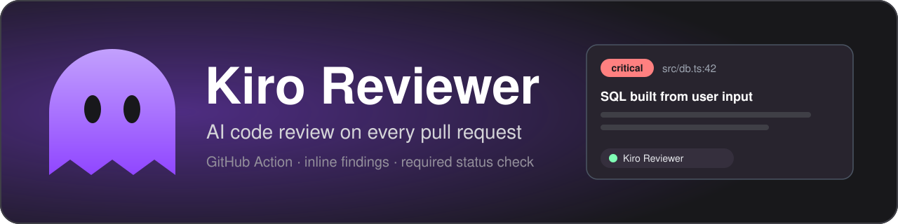

<p align="center"></p>

# Kiro Reviewer GitHub Action

Review pull requests with Kiro directly in GitHub. Kiro posts findings on the lines they affect and keeps one summary comment up to date as you push fixes. You can reply to a finding in its thread or use the **Kiro Reviewer** commit status to require a review before merging.

[Quick start](#quick-start) · [How it works](#how-it-works) · [Recipes](#recipes) · [Action inputs](#action-inputs)

## Quick start

**Repository workflow:** Store your Kiro API key as a repository secret and add one workflow. Reviews run automatically. Use this setup if you trust everyone who can push a branch to the repository to use the key: a same-repository PR can change its workflow before it merges. To require approval before a run gets the key, use a [protected environment](#optional-use-a-protected-environment) instead.

### 1. Add your Kiro API key to GitHub

1. Generate an API key in [Kiro Web](https://app.kiro.dev). Reviews belong to the Kiro account that owns the key. If your organization manages Kiro and key creation is unavailable, ask your administrator to [enable API keys](https://kiro.dev/docs/enterprise/governance/api-keys/).
2. In your GitHub repository, go to **Settings → Secrets and variables → Actions → New repository secret**.
3. Enter `KIRO_API_KEY` as the name, paste the key as the value, and select **Add secret**.

### 2. Add the workflow

Create `.github/workflows/kiro-review.yml` with the contents below. It uses release `v0.0.2`; to use a later version, replace the tag with one from the action's **Releases** page.

```yaml
name: Kiro Reviewer
on:
  pull_request:
    types: [opened, synchronize, reopened, ready_for_review]
  issue_comment:
    types: [created]
permissions:
  contents: read
  pull-requests: write
  issues: write
  statuses: write
jobs:
  review:
    if: >-
      (github.event_name == 'pull_request' && github.event.pull_request.head.repo.full_name == github.repository) ||
      (github.event_name == 'issue_comment' && github.event.issue.pull_request &&
       contains(fromJSON('["OWNER","MEMBER","COLLABORATOR"]'), github.event.comment.author_association) &&
       startsWith(github.event.comment.body, '/kiro-review'))
    concurrency:
      group: kiro-review-${{ github.event.pull_request.number || github.event.issue.number }}
      cancel-in-progress: ${{ github.event_name == 'pull_request' }}
    runs-on: ubuntu-latest
    timeout-minutes: 20
    steps:
      - uses: actions/checkout@11d5960a326750d5838078e36cf38b85af677262 # v4
        with:
          ref: ${{ github.event.pull_request.head.sha }}
          fetch-depth: 0
          persist-credentials: false
      - uses: kirodotdev/kiro-reviewer-action@v0.0.2
        with:
          kiro-api-key: ${{ secrets.KIRO_API_KEY }}
```

Keep `pull_request` (never `pull_request_target`) and `fetch-depth: 0` so the action can compare the branch histories. The job reads the PR checkout; do not add steps that execute code from it. Protect workflow changes with a `CODEOWNERS` rule for `.github/` and require code owner review before merging.

### 3. Verify the setup

Merge the workflow into your default branch. Open a small, non-draft PR **from a branch in the same repository**. In the **Actions** tab, open the **Kiro Reviewer** run.

When the run finishes, look for the **Kiro Reviewer** commit status and a summary comment on the PR. Inline comments appear when Kiro finds something to flag. Push another change to update the same summary. Kiro skips fork PRs and, by default, waits until a draft is marked ready for review.

**Optional: require the review before merging.** If every PR to the protected branch can run this workflow, add the **Kiro Reviewer commit status** to branch protection after its first run. Select the status rather than the workflow job so a review requested by PR comment can also update the required check.

If the branch accepts fork PRs, leave this status optional: neither a push nor `/kiro-review` posts a status for forks, so requiring it would block those merges. On a paused same-repository PR, new commits also get no automatic status. Comment `/kiro-review` to review the current commit, or `/kiro-review resume` to re-enable reviews on future pushes.

## How it works

1. **When you open a PR**, the action compares your branch with its merge base and sends Kiro the diff, your PR description and [review context](#what-code-does-kiro-receive). If you already reviewed the same diff with your Kiro account, the action can [skip a duplicate review](#why-was-a-review-skipped).
2. **When the review finishes**, Kiro posts a summary, opens inline threads for findings, labels the PR and sets the commit status. By default, an unresolved blocking finding fails the check.
3. **When you push a fix**, Kiro continues the review, updates the summary and tracks which findings are new, still present or resolved. After 20 iterations by default, the next push starts a fresh review.

### Work with review findings

- **Fix a finding:** Push your change. When a complete review no longer reports the finding, Kiro resolves its thread.
- **Give Kiro context:** Reply in the finding's thread. Kiro receives the latest eligible reply on the next push. A reply alone does not clear a blocking finding.
- **Dismiss a finding:** Resolve its thread, then comment `/kiro-review` to refresh the status. Resolving a thread suppresses the finding on the next run; it does not trigger a run itself. Anyone who can resolve the thread, including the PR author, can do this.

Repository owners, members, and collaborators can also post `/kiro-review pause` to stop reviews on new pushes or `/kiro-review resume` to turn them back on. Put the command on the first line of a PR comment. Comment commands work only after the workflow is on the default branch.

### Give Kiro repository-specific guidance

To give Kiro repository-specific guidance, add a `REVIEW.md` file at the repository root. Include conventions to check or areas that need extra attention. Kiro uses the version at the common ancestor of the PR and its base branch, so edits to the guidance take effect for later PRs after they merge.

`REVIEW.md` is plain Markdown that Kiro reads alongside the diff, written the way you would brief a human reviewer. It is redacted before it is sent and limited to 128 KB. For example:

```markdown
# Review guidance

- All database access goes through `src/db/`. Flag queries built anywhere else.
- Changes to the public API in `src/api/` need a matching update to `docs/api.md`.
- Don't comment on formatting; Prettier handles it.
```

This repository's own [`REVIEW.md`](REVIEW.md) asks Kiro to flag PRs that change user-visible behavior without updating this README.

For rules Kiro must enforce, add a `REVIEW_RULES.yaml` file at the repository root. Like `REVIEW.md`, it is read from the common ancestor, redacted before it is sent, and limited to 128 KB.

```yaml
# Findings below this confidence (1-10) are dropped. Default: 8.
default-rule:
  confidence-threshold: 7

custom-rules:
  # Blocking: any finding against this rule fails the check.
  - id: no-sql-concat
    rule: Build SQL with parameters, never by string concatenation or template literals.
    blocking: true
    file-patterns: ['src/**/*.ts']

  - id: handler-input-validation
    rule: >-
      Every API handler validates its request body with the zod schema in
      src/schemas before using it. Flag handlers that read req.body directly.
    blocking: true
    file-patterns: ['src/handlers/**/*.ts']

  # Non-blocking: reported, and fails the check only if its severity is blocking.
  - id: no-console-log
    rule: Use the logger in src/log.ts instead of console.log. Test files are exempt.
    file-patterns: ['src/**/*.ts']

  # No file-patterns: applies to every PR.
  - id: changelog-entry
    rule: User-visible behavior changes need an entry in CHANGELOG.md.

file-exclusions:
  use-defaults: true # keep the built-in generated, fixture, lock and vendored skips
  exclude: ['docs/gen/**', 'src/**/*.pb.ts']
  include: ['test/fixtures/contracts/**'] # review these even though fixtures are skipped by default
```

Each rule needs an `id` (letters, digits, `-` and `_`, at most 64 characters, unique) and a `rule` (at most 4,000 characters). `blocking` defaults to `false`. A rule with `file-patterns` applies only when the PR touches a matching file; a file can have up to 20 rules, each with up to 20 patterns. An unknown field or invalid YAML fails the review with `UNSUPPORTED_RULE_FIELD` or `INVALID_RULES`.

### What code does Kiro receive?

The action sends the redacted diff, commit messages, PR title and description, and repository review guidance. By default it also attaches modified and renamed text files (up to 20 files and 200 KB total) and sends tracked filenames so Kiro can request more context. The action answers up to two rounds of requests automatically; it skips secret-like paths and redacts the answers. To disable file attachments and context requests, set **both** `include-changed-files: false` and `context-rounds: 0`.

### Why was a review skipped?

If the same diff already has a completed review with no blocking findings under your Kiro account, the action can reuse that result. An empty diff also needs no review. A diff over 1 MB, 50 files, or 8,000 changed lines is skipped with a warning and fails the job by default. Split the PR to get it reviewed; `fail-on-skipped: false` changes the job outcome but does not review the oversized diff.

## Recipes

Start with the [quick start workflow](#quick-start). For recipes that show `with:`, add the inputs to the Kiro Reviewer step and keep its `kiro-api-key` input.

### Report findings without failing on them

Keep the inline comments and summary, but let the check pass when Kiro finds a blocking issue. A review error or an oversized diff can still fail the job.

```yaml
with:
  fail-on-blocking: false
```

### Review one service in a monorepo

Add `paths` to the existing `pull_request` trigger. The automatic review runs when the PR touches the service; `/kiro-review` comments still work on other PRs. A matching PR is reviewed in full, not just the files under `services/payments/`. Avoid this filter if every PR must report a required Kiro status.

```yaml
on:
  pull_request:
    types: [opened, synchronize, reopened, ready_for_review]
    paths: ['services/payments/**']
  issue_comment:
    types: [created]
```

### Run a quick review without extra file context

Kiro still receives the diff, commit messages, PR text and repository guidance. These settings disable file attachments and follow-up context requests.

```yaml
with:
  level: quick
  include-changed-files: false
  context-rounds: 0
```

### Review drafts automatically

```yaml
with:
  skip-drafts: false
```

### Use the Frankfurt region

```yaml
with:
  region: eu-central-1
```

See the [action reference](action.yml) for all inputs, defaults and outputs.

## Optional: use a protected environment

Choose this setup if someone should inspect workflow changes before a PR can use the key. Each push and each `/kiro-review` run needs a separate approval. Until the job starts, it cannot post a status for a new commit. If that status is required, the PR cannot merge while approval is pending.

1. Under **Settings → Environments**, create `kiro-review`. Add **required reviewers**, enable **Prevent self-review**, and save. The person who triggers a run cannot approve it. Make sure another trusted reviewer is available; a solo maintainer should use the repository workflow instead. If these settings are missing, check [GitHub’s plan requirements](https://docs.github.com/en/actions/reference/workflows-and-actions/deployments-and-environments#required-reviewers).
2. Add `KIRO_API_KEY` under **Environment secrets** instead of **Repository secrets**. If you are switching from the quick start, remove the repository copy so jobs outside the environment cannot use it.
3. In the quick start workflow, add `environment: kiro-review` to the `review` job at the same indentation as `runs-on`. Keep `kiro-api-key: ${{ secrets.KIRO_API_KEY }}` unchanged.
4. When a run requests approval, inspect the PR’s workflow changes before approving the `kiro-review` job.

## Action inputs

Set inputs under `with:` on the Kiro Reviewer step. For the quick start, only `kiro-api-key` needs a value from you.

| Input                   | What it does                                                                                                              | Valid values                                                                                     | Default                                    |
| ----------------------- | ------------------------------------------------------------------------------------------------------------------------- | ------------------------------------------------------------------------------------------------ | ------------------------------------------ |
| `kiro-api-key`          | Authenticates reviews with Kiro.                                                                                          | A Kiro API key supplied via a secret                                                             | `KIRO_API_KEY` environment variable if set |
| `github-token`          | Reads the PR and posts comments, labels and statuses.                                                                     | A GitHub token with the workflow permissions shown above                                         | `${{ github.token }}`                      |
| `region`                | Selects the Kiro region that receives the review.                                                                         | `us-east-1`, `eu-central-1`                                                                      | `us-east-1`                                |
| `level`                 | Sets the review depth.                                                                                                    | `quick`, `standard`, `deep`                                                                      | `standard`                                 |
| `include-changed-files` | Attaches the contents of modified and renamed text files as context.                                                      | `true`, `false`                                                                                  | `true`                                     |
| `context-rounds`        | Limits how many times Kiro can request more context. Use `0` to disable requests.                                         | `0`, `1`, `2`                                                                                    | `2`                                        |
| `iteration-budget`      | Sets how many iterations a PR review can use before the next update starts a fresh review.                                | Integers `1`–`20`                                                                                | `20`                                       |
| `skip-drafts`           | Waits until a draft is ready for review unless someone requests a review by comment.                                      | `true`, `false`                                                                                  | `true`                                     |
| `skip-existing`         | Skips the first review if the same diff already has a completed review with no blocking findings under your Kiro account. | `true`, `false`                                                                                  | `true`                                     |
| `fail-on-blocking`      | Fails the job when unsuppressed blocking findings remain.                                                                 | `true`, `false`                                                                                  | `true`                                     |
| `fail-on-skipped`       | Fails the job when the diff is too large to review. Set to `false` to warn instead.                                       | `true`, `false`                                                                                  | `true`                                     |
| `commit-status`         | Publishes the review status on the PR’s head commit.                                                                      | `true`, `false`                                                                                  | `true`                                     |
| `status-context`        | Names the commit status when `commit-status` is enabled.                                                                  | A status name (text)                                                                             | `Kiro Reviewer`                            |
| `labels`                | Labels the PR `kiro-review: blocking` or `kiro-review: clean`.                                                            | `true`, `false`                                                                                  | `true`                                     |
| `endpoint`              | Sets the service origin directly. If you also set `region`, both must select the same origin.                             | `https://app.kiro.dev`, `https://eu-central-1.app.kiro.dev`, or a custom HTTPS origin if enabled | Selected region’s origin                   |
| `allow-custom-endpoint` | Allows other HTTPS origins for `endpoint`. Only enable this for a host you trust with your Kiro API key.                  | `true`, `false`                                                                                  | `false`                                    |

## License

[Apache-2.0](LICENSE). See the [notice](NOTICE) and [third-party licenses](THIRD-PARTY-NOTICES).
